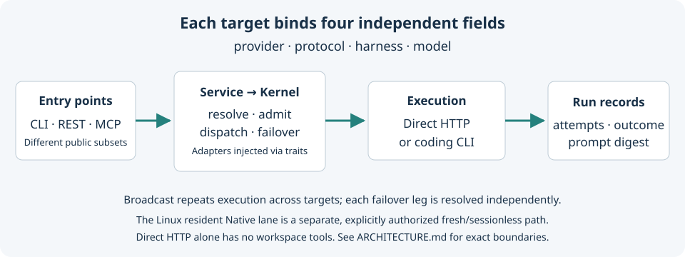

# Vyane

**하나의 Rust CLI와 오케스트레이션 커널로 AI 모델 작업을 실행하고 조율합니다.**

[English](README.md) · [简体中文](README.zh-CN.md) · [日本語](README.ja.md) · [한국어](README.ko.md) · [Español](README.es.md) · [Français](README.fr.md) · [Deutsch](README.de.md) · [Português (Brasil)](README.pt-BR.md)

소스 기준: `b46c194` · 워크스페이스 버전: `0.1.0` · 업데이트: 2026-10-15.
영문판을 기준으로 합니다. 이 번역은 기계의 도움을 받아 작성한 초안이며, 원어민 검수를 받았다고 주장하지 않습니다. 유지 관리 규칙은 [번역 정책](docs/TRANSLATING.md)을 참고하세요.

Vyane은 설정된 대상 하나에 작업을 보내거나, 여러 대상에 동시에 보내거나, 명시적으로 지정한 장애 전환 체인을 순서대로 시도합니다. 대상은 Claude Code 또는 Codex CLI 실행 어댑터를 사용하거나 HTTP 모델 엔드포인트를 직접 호출할 수 있습니다. 로컬 에이전트 워크플로를 만드는 개발자와 명시적인 라우팅, 실행 권한, 취소, 실행 기록이 필요한 Rust 애플리케이션 개발자를 위한 프로젝트입니다.


*AI로 생성한 개념 삽화이며, 아키텍처 다이어그램이 아닙니다. [이미지 안내](docs/assets/README.md).*

## 현재 상태와 한계

초기 단계의 프로젝트로, 소스에서 빌드해야 하며 API는 아직 안정적이지 않습니다. Cargo 버전은 **0.1.0**입니다. 로드맵의 v0.2–v0.4 같은 표기는 구현 마일스톤이며, 배포된 릴리스가 아닙니다. 2026-10-15 기준으로 저장소에는 Git 태그나 GitHub Releases가 없었습니다. 아래의 소스 빌드 빠른 시작을 이용하세요. 레지스트리를 통한 설치는 검증된 배포 경로가 아닙니다. [릴리스 체크리스트](docs/RELEASING.md)에는 현재의 차단 요인이 기록되어 있습니다. 워크스페이스에는 크레이트가 18개지만 게시 순서에는 17개만 나열되어 있어 `vyane-quota`가 빠져 있습니다.

| 공개 소스에서 사용할 수 있는 기능 | 한계 |
| --- | --- |
| 단일 대상 실행, 다중 대상 실행, 명시적인 장애 전환, 스트리밍, 로컬 기록 | 직접 HTTP 대상은 모델 응답을 제공하며, 파일 시스템이나 셸 도구를 제공하지 않습니다. |
| 결정적 라우팅과 선언형 워크플로 | 라우팅은 설정한 프로필에 따라 달라지며, 결과의 품질을 자동으로 보장하지 않습니다. |
| CLI, 루프백 REST API, 표준 입출력 MCP | 각 프런트엔드가 제공하는 기능 범위가 다릅니다. [CLI 가이드](docs/CLI-GUIDE.md)를 참고하세요. |
| 영속 작업, 로컬 메시지/목표, Linux 상주 Process/Native 실행 | Native 실행은 매번 새로 시작하며 세션이 없습니다. 승인 후 재개, 네이티브 세션 재개, 재시작 후 자동 재실행은 아직 구현되지 않았습니다. |
| 명시적인 권한, 정리된 자식 프로세스 환경, 실행 사용량 기록 | CLI 샌드박스 적용은 선택한 실행 어댑터에 위임됩니다. owner 필드와 루프백 인증은 동일한 OS 사용자 권한의 악성 프로세스에 대한 격리나 다중 사용자 격리를 제공하지 않습니다. |

CI 대상 플랫폼은 Linux와 macOS입니다. 일부 상주 실행 및 샌드박스 기능은 Linux 전용입니다. Windows 지원을 주장하지 않습니다. 모델 접근 권한, 자격 증명, 코딩 에이전트 CLI는 별도로 준비해야 합니다. 공급자 호출에는 비용이 발생할 수 있습니다. 빌드와 아래의 오프라인 검사는 모델을 호출하지 않습니다.

## 빠른 시작

Cargo가 포함된 안정 버전 Rust와 해당 플랫폼의 C/C++ 빌드 도구 모음을 설치하세요. 명시된 최소 Rust 버전은 1.88입니다. 저장소는 rustfmt와 Clippy가 포함된 stable 도구 모음을 선택합니다. 저장소 루트에서 실행하세요.

```sh
git clone https://github.com/zleo-ai/vyane-rs.git
cd vyane-rs
cargo install --locked --path crates/vyane-cli --root ./target/install
VYANE="$PWD/target/install/bin/vyane"
"$VYANE" --version
"$VYANE" --help
```

버전 출력은 `vyane 0.1.0`이어야 합니다. 현재 체크아웃 디렉터리 안에 설치되므로 PATH에 있는 다른 `vyane`을 대체하지 않습니다. 다음 명령을 실행할 수 있도록 현재 셸을 열어 두세요. 이 문서의 스냅샷을 재현하려면 설치 전에 `b46c194`를 체크아웃하세요. `main`은 변경될 수 있습니다.

### 자격 증명 없이 처음 실행하기

```sh
cat > ./target/offline-config.toml <<'TOML'
[providers.offline]
base_url = "https://example.invalid/v1"
auth_style = "bearer"
protocol = "openai_chat"
default_model = "offline-placeholder"

[profiles.offline]
provider = "offline"
harness = "none"
model = "offline-placeholder"
TOML
"$VYANE" --config ./target/offline-config.toml check
"$VYANE" --config ./target/offline-config.toml route "Explain this function" --json
```

`check`는 `offline` 프로필이 포함된 유효한 설정이라고 보고해야 합니다. `route`는 작업을 보내지 않고 `"selection_key": "offline"`과 `"model": "offline-placeholder"`가 포함된 JSON을 반환합니다. 이는 오프라인 설정 예제이며, 모의 모델 응답이나 실제로 작동하는 공급자가 아닙니다. 의도적으로 무효한 엔드포인트를 사용하므로 여기에 작업을 보내지 마세요.

### 실제 대상 설정하기

다음 구조로 `./target/model-config.toml`을 만드세요. 예시 엔드포인트와 모델을 공급자가 지원하는 값으로 바꾸세요. `example.invalid`는 의도적으로 작동하지 않는 예시 도메인입니다.

```toml
[providers.demo]
base_url = "https://example.invalid/v1"
api_key_env = "VYANE_DEMO_API_KEY"
auth_style = "bearer"
protocol = "openai_chat"
default_model = "YOUR_PROVIDER_MODEL_ID"

[profiles.chat]
provider = "demo"
protocol = "openai_chat"
harness = "none"
model = "YOUR_PROVIDER_MODEL_ID"
```

평소 사용하는 비밀 정보 관리 도구나 셸 환경을 통해 `VYANE_DEMO_API_KEY`를 설정하세요. 값을 TOML에 넣거나 커밋하지 마세요. 그런 다음 실행하세요.

```sh
"$VYANE" --config ./target/model-config.toml check
"$VYANE" --config ./target/model-config.toml dispatch "Explain a Rust trait in one paragraph" --target chat
```

첫 번째 명령은 설정과 자격 증명의 존재 여부를 확인합니다. 엔드포인트가 해당 자격 증명이나 모델을 받아들이는지는 확인하지 않습니다. 예시 값을 바꾸고 나면 두 번째 명령은 실제 요청을 보냅니다. 실제 공급자 호출의 성공 여부는 오프라인 빠른 시작 검증에 포함되지 않습니다. 코딩용 실행 어댑터, 권한, 여러 프로필, 장애 전환은 [설정 예제](profiles.example.toml)와 [CLI 가이드](docs/CLI-GUIDE.md)를 참고하세요.

## 대상의 동작 방식



| 필드 | 의미 |
| --- | --- |
| `provider` | 엔드포인트, 자격 증명 출처, 요금 청구에 사용되는 식별 정보. |
| `protocol` | 통신 형식: OpenAI Chat, OpenAI Responses, Anthropic Messages. |
| `harness` | Claude Code 또는 Codex CLI 같은 실행 어댑터. `none`은 직접 HTTP 호출을 뜻합니다. |
| `model` | 해당 공급자의 네임스페이스 안에서 사용하는 모델 식별자. |

프로필은 이 네 필드를 묶습니다. 장애 전환 체인의 각 대상은 별도로 해석되므로, 모델 식별자가 다른 공급자에 암묵적으로 재사용되지 않습니다. 커널은 공유 트레이트에 의존하고, 서비스는 구체적인 어댑터를 조립합니다. 의존성과 권한의 세부 사항은 [아키텍처](docs/ARCHITECTURE.md)를 참고하세요.

## 예제와 참고 자료

명령에서 사용하는 이름의 프로필을 설정한 뒤, 다음 예제로 사용 범위를 넓힐 수 있습니다.

```sh
"$VYANE" --config ./target/model-config.toml dispatch "Explain this algorithm" --target chat --stream
"$VYANE" --config ./target/model-config.toml broadcast "Compare two implementation approaches" --targets chat,review
"$VYANE" --config ./target/model-config.toml route "Review this design" --json
```

다중 대상 실행 예제에는 `review`라는 두 번째 프로필이 필요합니다. 프롬프트는 문자 그대로의 텍스트입니다. 파일을 언급해도 해당 내용이 직접 HTTP 요청에 첨부되지는 않습니다. [CLI 가이드](docs/CLI-GUIDE.md)는 워크플로, 데몬 수명 주기, REST 인증, MCP, 로컬 메시지와 목표를 다룹니다. 각 하위 명령에 `--help`를 사용하면 현재 명령 인터페이스를 확인할 수 있습니다.

## Python Vyane과의 관계

이 저장소는 기존 비공개 Python Vyane 시스템의 기능을 Rust로 구현한 공개 프로젝트입니다. 그대로 교체해서 쓸 수 있는 구현은 아닙니다. 이전하기 전에 Python 명령, 설정, 저장된 세션, 워크플로, 운영 연동을 각각 확인해야 합니다. 문서화된 이전 경로 없이 두 구현이 동일한 상태 디렉터리를 사용하게 하지 마세요.

[공개 기능 매트릭스](docs/parity/ORIGINAL-VYANE-PARITY.md)는 8개 영역의 53개 기능을 추적합니다. 구현 완료 7개, 부분 구현 23개, 미구현 12개, 의도적으로 다르거나 결정을 기다리는 기능 9개, 계획됨 2개입니다. [민감 정보를 제거한 매니페스트](docs/parity/fixtures/v1/manifest.json)에는 5개 테스트 묶음의 44개 사례가 있습니다. 정규화 후 일치하는 사례가 30개, 미해결 차이가 있는 사례가 14개입니다. 이는 범위가 제한된 동작 검사이며, 전체 시스템의 동등성 비율을 나타내지 않습니다. 공개 Rust 구현의 검증 근거를 다시 계산하려면 다음을 실행하세요.

```sh
python3 .github/scripts/parity-report.py --format markdown
```

이 명령은 Rust 픽스처 검사를 실행하고, 저장된 민감 정보 제거 검증 증빙을 확인합니다. 비공개 참조 구현은 실행하지 않습니다. 공개 프로젝트 기여자는 비공개 소스에 접근할 필요가 없습니다. 미완료 작업은 [로드맵](docs/ROADMAP.md), 공개 저장소의 변경 사항은 [변경 기록](docs/CHANGELOG.md)을 참고하세요.

## 기여와 도움 받기

검사 항목과 검토 규칙은 [CONTRIBUTING.md](CONTRIBUTING.md)에서 먼저 확인하세요. 재현 가능한 버그 보고, 더 간단한 예제, 번역 수정, 문서에 명시된 기능 공백에 대한 테스트가 유용한 기여입니다. 겹칠 수 있는 작업을 시작하기 전에 [Issues](https://github.com/zleo-ai/vyane-rs/issues)와 [열린 PR](https://github.com/zleo-ai/vyane-rs/pulls)을 검색하세요. 보고에는 소스 리비전, OS, Rust 버전, 최소 재현 절차, 민감 정보를 제거한 출력을 포함하세요. 키, 비공개 프롬프트, 개인 파일 시스템 경로는 절대 포함하지 마세요.

취약점은 세부 내용을 공개하기 전에 [SECURITY.md](SECURITY.md)의 안내를 따르세요. 번역 범위와 검수 상태는 [TRANSLATING.md](docs/TRANSLATING.md), 릴리스 및 버전 유지 관리는 [RELEASING.md](docs/RELEASING.md)를 참고하세요.

## 라이선스

[MIT](LICENSE-MIT) 또는 [Apache-2.0](LICENSE-APACHE) 이중 라이선스로 제공되며, 둘 중 하나를 선택할 수 있습니다. 기여에도 같은 조건이 적용됩니다. [기여 안내](CONTRIBUTING.md#licensing)를 참고하세요.
